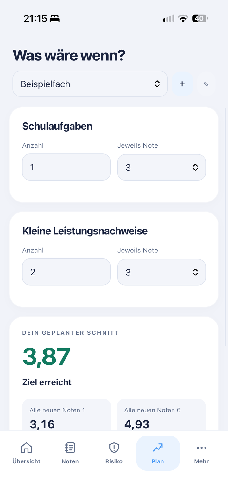

# Notenkompass

Notenkompass ist ein Notenrechner für einzelne Schulfächer. Du kannst Schulaufgaben und kleine Leistungsnachweise mit ihrer jeweiligen Gewichtung eintragen. Daraus wird der aktuelle Durchschnitt berechnet.

Eine einstellbare Zielgrenze hilft dabei, den aktuellen Stand einzuordnen. Mit der Planung kannst du mögliche kommende Noten durchspielen und sehen, wie sie den Schnitt verändern würden. Die Risikoansicht zeigt rechnerisch, welche weiteren Noten mit der gewählten Zielgrenze vereinbar sind.

Es gibt eine Handy- und eine Computeransicht. Fächer und Noten werden im Browser gespeichert und lassen sich als Datei exportieren und wieder öffnen.

[Website](https://ewmogilev.github.io/Notenkompass/)

## Screenshots

### Computer

### Handy

<table>
  <tr>
    <th>Übersicht</th>
    <th>Noten</th>
    <th>Planung</th>
  </tr>
  <tr>
    <td></td>
    <td></td>
    <td></td>
  </tr>
</table>

Die Ergebnisse dienen zur Orientierung und können von den offiziellen Schulnoten abweichen.

Erstellt von **Ewan Mogilevsky**.
